# ERD

> 이슈 #17(초기 스키마), #67(나무돌보미 연계 개정). 기준은 중간보고서 붙임 2 "전체 ERD 개정안"이다.
> DB는 PostgreSQL 17 + PostGIS다.
> 실제 컬럼 타입·제약조건은 `migrations/`가 기준이다. 이 다이어그램의 타입(`varchar` 등)은 개념용이고, 실제로는 `text`를 쓴다. 현재 DB 전체 구조는 `schema.sql`에서 볼 수 있다.

2026-10-29 주제를 바꾸면서(유료 입양 TreeMate → 나무돌보미 연계 TreeCare) `20261112120000_treecare_revision.sql`로 다음을 바꿨다.

- 삭제: `adoptions`(입양), `fund_transactions`(관리기금), `trees.water_need`(물 필요도), 물주기·관찰 기록
- 변경: `adoptions` → `caregiver_applications`(나무당 1명 제약 없음), `records.type`은 `activity`·`report`, `stories`는 나무 기준 공동 이야기, `story_entries`에 글쓴 돌보미
- 추가: `monthly_reports`, `volunteer_hours`, `rental_items`, `rentals`, `user_badges`, `organizations`, `organization_members`, `story_reactions`

## 다이어그램

```mermaid
erDiagram
    users ||--o{ caregiver_applications : "신청한다"
    users ||--o{ records : "기록한다"
    users ||--o{ monthly_reports : "제출한다"
    users ||--o{ volunteer_hours : "인정받는다"
    users ||--o{ rentals : "받는다"
    users ||--o{ user_badges : "받는다"
    users ||--o{ organization_members : "가입한다"
    users ||--o{ story_entries : "덧붙인다"
    users ||--o{ notifications : "받는다"
    trees ||--o{ caregiver_applications : "돌봄 대상"
    trees ||--o{ records : "기록된다"
    trees ||--o| stories : "공동 이야기"
    stories ||--o{ story_entries : "덧붙인 글"
    story_entries ||--o{ story_reactions : "받은 호응"
    monthly_reports ||--o{ records : "모은다"
    monthly_reports ||--o| volunteer_hours : "승인 시 기록"
    records ||--o| reports : "신고 상세"
    records ||--o{ record_photos : "사진 (최대 3장)"
    rental_items ||--o{ rentals : "지급한다"
    organizations ||--o{ organization_members : "소속"
    organizations ||--o{ organization_sections : "관심 구간"

    users {
        bigint id PK
        varchar email UK
        varchar password_hash
        varchar nickname
        varchar real_name "이야기 실명 공개용"
        varchar role "citizen | officer"
        varchar agency "구청 담당자의 소속 관리청"
        timestamptz education_completed_at "교육 이수 시각, null=미이수"
        timestamptz created_at
    }

    trees {
        bigint id PK
        varchar source_key UK "관리청|경도|위도, 원본에 관리번호가 없음"
        varchar code UK "관리번호 자치구코드-순번, assign_tree_codes()가 채움"
        int place_no "나무 이름 번호: 같은 길 안 순번, assign_tree_codes()가 채움"
        varchar species "수종"
        geography location "Point, WGS84"
        varchar agency "관리청: 신청·보고서·신고 배정 기준"
        varchar district "위치한 자치구"
        varchar dong "위치한 법정동"
        varchar road_name "노선"
        varchar address "지번 주소"
        varchar health_status "good | check | urgent"
        timestamptz status_updated_at
        timestamptz created_at
    }

    caregiver_applications {
        bigint id PK
        bigint user_id FK
        bigint tree_id FK
        varchar status "pending | approved | rejected | ended"
        date period_start "활동 기간"
        date period_end "시작일 + 1년 전날 (서버가 정함)"
        text applicant_name "신청인 성명/단체명"
        text contact_person "기업·단체 담당부서·담당자"
        int headcount "신청 인원"
        char postal_code "우편번호"
        text address
        text phone "연락처"
        varchar participation_type "individual | company | civic_group | religious_group | village_community | other"
        text motivation "신청사유"
        text activity_plan "활동계획 (별첨 2)"
        text organization_intro "기업·단체 소개 (별첨 1, 선택)"
        timestamptz agreed_at "참여 안내 사항 동의 시각"
        text reject_reason "반려 사유"
        bigint reviewed_by FK "심사한 구청 담당자"
        timestamptz reviewed_at
        timestamptz created_at
    }

    records {
        bigint id PK
        bigint tree_id FK
        bigint user_id FK
        varchar type "activity | report"
        timestamptz recorded_at
        date activity_date "활동한 날"
        varchar activity_kind "한 일. 여러 개면 쉼표+공백으로 이음"
        int duration_min "활동 시간(분)"
        text memo
        varchar photo_url "첫 사진 (전체는 record_photos)"
        geography location "신고한 위치, Point (활동 기록은 저장 안 함)"
        varchar verification "기록 검증: none | location | photo"
        bigint monthly_report_id FK "제출되면 채움"
        timestamptz created_at
    }

    record_photos {
        bigint id PK
        bigint record_id FK
        text url "/uploads/파일이름"
        smallint position "1~3, 올린 순서"
        timestamptz created_at
    }

    monthly_reports {
        bigint id PK
        bigint user_id FK
        varchar agency "제출할 관리청"
        varchar status "submitted | approved | revision_requested"
        int total_minutes "고른 기록의 활동 시간 합계"
        text review_note "보완 요청 사유"
        bigint reviewed_by FK
        timestamptz reviewed_at
        timestamptz submitted_at
    }

    volunteer_hours {
        bigint id PK
        bigint user_id FK
        bigint monthly_report_id FK,UK "중복 인정 방지"
        int minutes
        bigint recorded_by FK "승인한 구청 담당자"
        timestamptz recorded_at
    }

    reports {
        bigint id PK
        bigint record_id FK,UK
        varchar record_type "항상 report, 신고 기록에만 붙도록 FK에 씀"
        varchar category "leaning | broken_branch | pest | withering | other"
        varchar urgency "low | high, 유형으로 결정"
        varchar status "pending | inspecting | resolved"
        varchar agency "배정 관리청"
        boolean is_trusted "신고 시점 교육 이수 여부"
        bigint handled_by FK "처리한 구청 담당자"
        text action_note "조치 내용"
        timestamptz inspected_at
        timestamptz resolved_at
        timestamptz created_at
    }

    rental_items {
        bigint id PK
        varchar agency "보유 관리청"
        varchar name "예: 쿨토시, 집게"
        int stock "아직 배정하지 않은 재고"
        timestamptz created_at
    }

    rentals {
        bigint id PK
        bigint item_id FK
        bigint user_id FK
        int quantity
        varchar status "requested | approved | rejected | received"
        text reject_reason "반려 사유(선택)"
        bigint handled_by FK "승인·반려한 구청 담당자"
        timestamptz handled_at
        timestamptz received_at
        timestamptz created_at
    }

    stories {
        bigint id PK
        bigint tree_id FK,UK "나무별 공동 이야기"
        varchar tree_name "나무에 붙인 이름 (선택)"
        text body "(선택)"
        varchar photo_url "대표 사진"
        boolean is_public "쓰지 않음 (글마다 story_entries.is_public)"
        timestamptz created_at
        timestamptz updated_at
    }

    story_entries {
        bigint id PK
        bigint story_id FK
        bigint user_id FK "덧붙인 돌보미"
        varchar author_display "real_name | nickname"
        boolean is_public "글쓴 돌보미가 고름. false 면 QR 페이지에 안 나옴"
        text body
        varchar photo_url
        timestamptz created_at
    }

    story_reactions {
        bigint id PK
        bigint story_entry_id FK
        varchar kind "like | reply"
        varchar body "한 줄 응답, 80자"
        varchar device_key "로그인 없이 기기 구분"
        date reacted_on "하루 한 번 제약용, 한국 날짜"
        timestamptz created_at
    }

    user_badges {
        bigint id PK
        bigint user_id FK
        varchar badge_code "예: 우리 동네 나무돌보미"
        timestamptz earned_at
    }

    organizations {
        bigint id PK
        varchar name "단체 이름"
        varchar invite_code UK "초대 코드"
        timestamptz created_at
    }

    organization_members {
        bigint id PK
        bigint organization_id FK
        bigint user_id FK
        varchar role "admin | member"
        timestamptz joined_at
    }

    organization_sections {
        bigint id PK
        bigint organization_id FK
        varchar district "자치구"
        varchar place "길: 노선명 → 동 → 자치구 중 있는 것"
        timestamptz created_at
    }

    weather {
        date date PK
        varchar region PK "seoul"
        numeric precipitation_mm
        numeric temp_avg
        numeric temp_max
        boolean is_heatwave
    }

    notifications {
        bigint id PK
        bigint user_id FK "수신자"
        varchar type "아래 상태값 참고"
        bigint tree_id FK
        bigint report_id FK
        varchar title
        text body
        timestamptz read_at
        timestamptz created_at
    }
```

## 상태값

DB에는 영어 코드로 저장하고, 화면에는 한국어로 보여 준다.

| 컬럼 | 코드 | 화면 표시 |
|---|---|---|
| `caregiver_applications.status` | `pending` / `approved` / `rejected` / `ended` | 대기 / 승인 / 반려 / 종료 |
| `monthly_reports.status` | `submitted` / `approved` / `revision_requested` | 검토 대기 / 승인 / 보완 요청 |
| `rentals.status` | `requested` / `approved` / `rejected` / `received` | 신청 / 승인 / 반려 / 수령 |
| `reports.status` | `pending` / `inspecting` / `resolved` | 확인 필요 / 현장 확인 / 조치 완료 |
| `records.type` | `activity` / `report` | 활동 기록 / 이상 신고 |
| `story_reactions.kind` | `like` / `reply` | 좋아요 / 한 줄 응답 |
| `organization_members.role` | `admin` / `member` | 단체 관리자 / 회원 |
| `notifications.type` | `application_result` / `monthly_report_result` / `rental_result` / `report_resolved` / `story_reaction` | 신청 결과 / 보고서 결과 / 물품 결과 / 조치 완료 / 받은 호응 |
| `trees.health_status` | `good` / `check` / `urgent` | 양호 / 확인 필요 / 긴급 |
| `users.role` | `citizen` / `officer` | 시민 / 구청 담당자 |

- 신고 상태는 `pending → inspecting → resolved` 순서로만 바뀐다. 되돌리기는 두지 않는다.
- 보고서는 `submitted → approved` 또는 `submitted → revision_requested → (다시 제출) submitted`로 바뀐다.
- 물품은 `requested → approved → received` 또는 `requested → rejected`로 끝난다. 반납 상태는 없다.

## 설계 결정

- **돌봄 관계는 다대다**: 한 명이 여러 그루, 한 그루에 여러 명이 돌본다. 그래서 `caregiver_applications`에는 나무당 1명 제약이 없다. 대신 같은 사람이 같은 나무에 대기·승인 중인 신청을 둘 갖지 못하게 `(user_id, tree_id)`에 `status IN ('pending', 'approved')` 부분 유니크 인덱스를 건다. 반려·종료 뒤 재신청은 된다.
- **저장하지 않고 계산하는 값**: 다른 테이블에서 바로 구할 수 있어서 컬럼으로 두지 않았다. 컬럼으로 두면 원본과 값이 어긋날 수 있다.
  - 나무의 돌보미 여부·돌보미 수: `caregiver_applications`에서 `status = 'approved'`인 행으로 판단한다.
  - 스탬프 수: `records`(`type = 'activity'`) 수를 센다. 5·10회가 되면 `user_badges` 행을 만든다.
  - 나이테 신고·조치 표식: `reports.created_at`·`resolved_at`을 한국 시간 월별로 센다. 나이테 집계는 `backend/common/incident-markers.ts`의 `monthlyIncidentMarkers(db, treeId, year)`를 부른다(#21).
- **보고서와 기록**: 보고서를 제출하면 고른 날짜의 활동 기록에 `monthly_report_id`를 채운다. 보고서 작성 화면은 `monthly_report_id IS NULL`인 기록이 있는 날짜만 보여 주므로, 이미 제출한 날짜는 다시 고를 수 없다.
  - `records (monthly_report_id, user_id)`가 `monthly_reports (id, user_id)`를 참조해서 남의 보고서에 기록이 묶이는 것을 DB가 막는다. `volunteer_hours`도 같은 방식이다.
  - 이상 신고(`type = 'report'`)는 보고서에 묶이지 않는다(CHECK).
  - `monthly_reports.agency`는 구청 검토 대기 목록의 기준이다. 보고서 하나는 한 관리청에 낸다. 시민-BE는 묶인 기록의 나무 `agency`로 채운다.
- **봉사시간 중복 방지**: `volunteer_hours.monthly_report_id`에 유니크 제약을 걸어 같은 보고서가 두 번 인정되는 것을 DB에서 막는다. 구청-BE는 보고서 승인(`status = 'approved'`), 봉사시간 행 생성, 알림 생성을 한 트랜잭션으로 묶는다.
- **기록과 신고**: 신고도 기록의 한 종류라서 `records`에 공통 정보(나무·작성자·사진·위치)를 두고, 신고에만 있는 처리 정보는 `reports`에 1:1로 둔다. 시민-BE는 두 행을 함께 만들고, 구청-BE는 `reports`의 처리 컬럼만 바꾼다.
  - `reports`는 `(record_id, record_type)`으로 `records(id, type)`를 참조하고 `record_type`은 항상 `report`다. 그래서 활동 기록에 신고가 잘못 붙는 것을 DB가 막는다.
- **상태 전이**: `reports`는 `inspected_at` 없이 `inspecting`/`resolved`가 될 수 없고, `resolved`일 때만 `resolved_at`이 있다. 신청서·보고서·물품도 승인·반려 상태면 처리한 담당자와 시각이 있어야 하고, 반려는 사유, 보완 요청은 의견이 있어야 한다.
- **신뢰도**: `is_trusted`는 신고할 때의 교육 이수 여부를 복사해 둔다. 나중에 이수하더라도 그전 신고의 신뢰도는 바뀌지 않는다.
- **물품 재고**: `rental_items.stock`은 "아직 배정하지 않은 수량"이고 0 아래로 내려갈 수 없다(CHECK). 구청-BE는 **승인할 때** 신청 수량만큼 줄이고(배정), 수령은 상태만 바꾼다. 그래서 재고보다 많이 승인할 수 없다. 승인·재고 차감·알림은 한 트랜잭션이고, 신청과 물품 행을 함께 잠가 동시에 승인해도 재고가 음수가 되지 않는다. 반려 사유(`reject_reason`, #70)는 선택 입력이다.
- **공동 이야기**: 이야기는 나무당 하나(`stories.tree_id` 유니크)이고, 여러 돌보미가 `story_entries`로 글을 덧붙인다. 실명/별명 선택(`author_display`)과 공개 여부(`is_public`, 마이그레이션 20261120150000)는 글마다 글쓴 돌보미가 한다. `stories`는 묶음이라 `tree_name`·`body`는 비워 둘 수 있고, `stories.is_public`은 쓰지 않는다.
- **받은 호응**: 로그인 없이 남기므로 `device_key`로 기기를 구분한다. 같은 기기는 글 하나에 하루 한 번만 남길 수 있게 `(story_entry_id, device_key, reacted_on)`에 유니크 제약을 건다. `reacted_on`은 한국 날짜 기준이다. 한 줄 응답은 80자까지다.
- **단체 관리자**: `users.role`이 아니라 `organization_members.role = 'admin'`으로 판단한다. 단체 관리자도 자기 나무를 돌보는 돌보미다.
- **위치**: `geography(Point, 4326)`을 쓴다. 위치 확인 거리는 `ST_DWithin`, 지도 범위 조회는 공간 인덱스(GiST)로 처리한다.
- **기록 검증(#13)**: 활동 기록을 남길 때 보낸 내 위치가 나무에서 30m(`LOCATION_CHECK_DISTANCE_M`) 안이고 휴대폰 위치 오차가 30m(`MAX_LOCATION_ACCURACY_M`) 이하면 `verification = 'location'`, 아니면 사진이 꼭 있어야 하고 `'photo'`로 남긴다. 두 값은 `citizen/records.ts` 위쪽 상수이고 구청 확인 전 임시값(#59)이다. 확인에 쓴 내 위치 좌표는 저장하지 않는다(`records.location`은 신고만 채운다). `'none'`은 신고와 이 규칙 전에 남긴 기록이다.
- **관리청과 위치를 나눈다**: 가로수 데이터의 관리 주체(관리청)는 나무가 서 있는 자치구와 다를 수 있다(아래 "가로수 원본 데이터" 참고).
  - `agency`(관리청): 신청 심사·보고서 검토·물품·신고 배정과 구청 담당자 권한의 기준. 25개 자치구 + `서울시설공단` + `중부공원여가센터`.
  - `district`, `dong`(위치): 지도 필터와 동·노선 집계의 기준.
  - 둘 다 별도 테이블 없이 문자열로 둔다.

## 나무 관리번호 `trees.code` (마이그레이션 20261112190000_add_tree_code, #4)

서울시 트리맵에는 가로수마다 관리번호가 있지만 열린데이터광장 파일에는 없다. 그래서 우리가 번호를 새로 매긴다. 시연 때는 "서울시 번호로 바꿔 끼우면 된다"고 설명한다.

- 형식: `자치구코드-구 안 순번` 5자리-5자리. 예 `11140-00123` = 중구 123번째. 자치구코드는 행정표준 시군구 코드(`district_codes` 테이블, 25개 구).
- 부여: `SELECT assign_tree_codes();` — `code`가 비어 있는 나무에만 매기고, 구마다 쓰인 가장 큰 순번 다음부터 이어 붙인다. 기존 번호는 바뀌지 않는다. 순서는 노선명 → 경도 → 위도.
- 적재 스크립트가 새 나무를 넣은 뒤 이 함수를 한 번 부른다. 매년 재적재는 `source_key`로 같은 나무를 찾으므로 번호가 유지된다.
- 화면·QR 명판에는 `id` 대신 이 번호를 보여 준다.

## 나무 이름 번호 `trees.place_no` (마이그레이션 20261124140000_tree_place_no)

같은 길에 같은 수종이 수십~수백 그루라 "은행나무, 소파로"만으로는 나무를 구분할 수 없다(적용 전 서울에서 이름이 겹치는 묶음 4,602개). 그래서 이름을 `은행나무, 소파로 3번`처럼 부른다(`common/tree-name.ts`의 `treeNameSql()`).

- 길: `COALESCE(road_name, dong, district)`. 같은 이름의 길이 여러 구에 걸쳐도 서울 전체에서 번호를 이어 매기므로 서울 전체에서 이름이 겹치지 않는다(유니크 인덱스 `trees_place_no_key`).
- 부여: `assign_tree_codes()`가 관리번호를 매긴 뒤 `place_no`가 비어 있는 나무에 매긴다. 길마다 쓰인 가장 큰 번호 다음부터 관리번호 순으로 이어 붙인다. 기존 번호는 바뀌지 않는다. 적재 스크립트는 따로 고칠 것이 없다.
- 원본 갱신으로 길(노선명·동·자치구)이 바뀐 나무는 트리거 `trees_reset_place_no`가 번호를 비우고, 다음 `assign_tree_codes()`에서 새 길의 다음 번호를 받는다.

## 단체 관심 구간 `organization_sections` (마이그레이션 20261126120000_organization_sections, #143)

단체가 도로·거리 구간을 골라 두면, 그 구간의 **모든 돌보미**(단체 회원이 아니어도) 활동을 구간·나무 단위 **익명 합계**로 본다(`GET /organizations/{id}/section-report`). 사람은 세기만 하고 내보내지 않는다.

- 구간 = 자치구(`district`) + 길(`place` = 나무의 `COALESCE(road_name, dong, district)`). 같은 이름의 길도 자치구가 다르면 다른 구간이다. `(organization_id, district, place)` 유일.
- 관리자만 추가·삭제, 회원은 조회. 단체를 지우면 같이 지운다(`ON DELETE CASCADE`). 단체당 20개(임시값, 코드 상수).
- 구간의 나무를 찾는 조회를 위해 `trees_section_idx (district, COALESCE(road_name, dong, district))` 인덱스를 둔다.

## 돌보미 신청서 양식 항목 (마이그레이션 20261117120000_application_form_fields, #6)

구청 「나무돌보미(Adopt a Tree) 신청서(안)」 양식의 항목을 `caregiver_applications`에 칸으로 넣었다.

- 신청인(성명/단체명), 담당부서·담당자(기업·단체만 필수), 신청 인원, 우편번호·주소, 연락처, 참여유형, 신청사유(`motivation`), 활동계획, 기업·단체 소개, 안내 사항 동의 시각.
- 양식의 '입양대상지'는 가로수뿐이라 칸을 두지 않는다(`tree_id`가 대상). 별첨 파일은 받지 않고 활동계획·소개를 글로 받는다.
- 활동 기간은 양식대로 1년 기본이다. 시민은 시작일만 고르고 `period_end`는 서버가 시작일 + 1년 전날로 정한다.
- 이 마이그레이션 전에 만든 신청서가 있어서 새 칸은 NULL을 허용한다. 필수 여부는 시민-BE API(zod)가 검사한다.
- 여러 그루를 한 번에 내면 양식 항목은 그루마다 같은 값이 들어간다.

## 기록 사진 `record_photos` (마이그레이션 20261120120000_record_photos, #5)

- 시민 웹은 활동 기록·이상 신고 하나에 사진을 3장까지 올린다. 파일은 백엔드 `uploads` 폴더(`UPLOAD_DIR`)에 무작위 이름으로 두고, DB에는 주소(`/uploads/파일이름`)만 남긴다.
- `records.photo_url`에는 첫 사진을 계속 넣는다. 구청 신고 큐·보고서 검토가 그 칸을 읽기 때문이다.
- 기록을 지우면 사진 행도 같이 지워진다(`ON DELETE CASCADE`). 파일 정리는 아직 없다.
- '한 일'을 여러 개 고르면 `records.activity_kind`에 `, `로 이어 저장한다. 그래서 한 일 이름에는 쉼표를 쓸 수 없다.

## 가로수 원본 데이터 (#18)

[서울시 가로수 위치 정보(경도, 위도)](https://data.seoul.go.kr/dataList/OA-22904/S/1/datasetView.do), 2026년판 xlsx를 확인한 결과다. 공공누리 제4유형이라 원본은 커밋하지 않는다.

- 287,636그루. 시트 27개(관리청별)이고, 각 시트의 컬럼은 `자치구`(실제로는 관리청), `노선`, `수종`, `도로명 주소`, `지번 주소`, `좌표(경도)`, `좌표(위도)` 7개다.
- **관리번호가 없다.** 그래서 `source_key`를 `관리청|경도|위도`로 만들어 유니크 키로 쓴다. 매년 새 파일로 다시 적재할 때 이 키로 같은 나무를 찾는다. 좌표가 완전히 같은 행이 58개 있어서 적재할 때 중복을 걸러 낸다.
- **관리청 ≠ 위치 자치구**: 자치구가 관리하는 나무 중 1,307그루는 다른 자치구에 서 있다(예: 용산구 관리, 마포구 공덕동 위치). `서울시설공단`(12,223그루)과 `중부공원여가센터`(727그루)는 자치구가 아닌 관리청이다.
- **동**: 따로 컬럼이 없어서 지번 주소에서 법정동을 꺼낸다(457개 동). 지번 주소가 빈 1,098그루는 동을 비워 두고, 필요하면 행정구역 경계 데이터와 공간 조인해서 채운다.
- **좌표**: WGS84 경도·위도라서 변환 없이 `geography(Point, 4326)`에 넣는다. 좌표가 없는 행은 1개다.
- **수종 "공분"(5,881행)**: 나무가 없는 빈 식재 자리로 보인다. 확인될 때까지 적재에서 뺀다.

기상 데이터는 [기상청 지상(종관, ASOS) 일자료 조회서비스](https://www.data.go.kr/data/15059093/openapi.do)(`getWthrDataList`, 서울 지점 `108`)를 쓴다. 일강수량 `sumRn`, 평균기온 `avgTa`, 최고기온 `maxTa`를 `weather`에 넣는다. 서울에 ASOS 지점이 1곳이라 `region`은 `seoul`로 시작한다.

## 담당 경계 (CLAUDE.md 시민·구청 경계 규칙)

| 테이블 | 쓰는 쪽 | 비고 |
|---|---|---|
| `caregiver_applications` | 생성: 시민-BE / 심사(상태·반려 사유·심사자): 구청-BE | |
| `records`, `monthly_reports` | 작성·제출: 시민-BE / 보고서 검토(상태·의견·검토자): 구청-BE | |
| `volunteer_hours` | 구청-BE | 보고서 승인과 한 트랜잭션 |
| `rental_items` | 구청-BE | 재고 관리 |
| `rentals` | 생성: 시민-BE / 승인·반려·수령: 구청-BE | |
| `reports` | 생성: 시민-BE / 상태·조치 컬럼: 구청-BE | |
| `notifications` | 시민-BE 알림 모듈 | 구청-BE는 알림 생성 함수만 호출 |
| `stories`, `story_entries`, `story_reactions`, `user_badges`, `organizations`, `organization_members` | 시민-BE | 구청-BE는 읽기만(단체별 필터) |
| `trees`, `weather` | 공공데이터 적재 스크립트 | |

## 기본값

### 신고 유형과 긴급도

긴급도는 시민이 고르지 않고 신고 유형으로 정한다. 시민이 고르게 하면 대부분 "긴급"을 고르게 되어 큐 정렬이 의미가 없어진다. 시민-BE가 신고를 만들 때 아래 표대로 `urgency`를 채운다.

| `reports.category` | 화면 표시 | `urgency` |
|---|---|---|
| `leaning` | 기울어짐·쓰러짐 | `high` |
| `broken_branch` | 가지 꺾임 | `high` |
| `pest` | 병해충 의심 | `low` |
| `withering` | 시듦·고사 의심 | `low` |
| `other` | 기타 | `low` |

### 그 밖의 기본값

- 신청서 항목(`motivation` 외), 활동 선택 항목(`records.activity_kind`의 값), 배지 코드는 구청 양식 확인(#59) 후 설정 파일로 정한다. DB에는 CHECK를 걸지 않는다.
- 기상 데이터는 서울 관측소 1곳(`region = 'seoul'`)으로 시작한다. 자치구별 값이 필요하면 방재기상관측(AWS) 자료를 따로 검토한다.
- 이 ERD에 넣지 않은 기능(교육·퀴즈 응시 기록, 타임캡슐)은 담당자가 테이블을 추가할 때 이 문서에 이어서 적는다.
