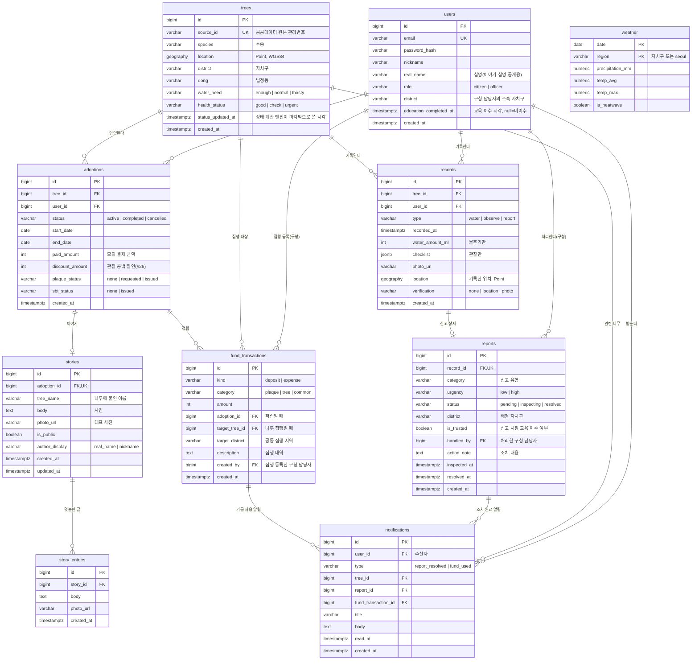

# ERD (초안)

> 이슈 #17. 팀 리뷰 전 초안이다. 확정되면 이 문서를 기준으로 마이그레이션을 만든다.
> DB는 PostgreSQL + PostGIS 기준이다(#52에서 확정 대기).

수행계획서의 엔티티 9개(Tree, User, Adoption, Story, Record, Report, Weather, Fund, Notification)를 테이블로 옮겼다.
이야기의 "덧붙인 글 목록"은 여러 개라서 `story_entries` 테이블 하나를 더 두었다.

## 다이어그램

## 상태값

DB에는 영어 코드로 저장하고, 화면에는 한국어로 보여 준다.

| 컬럼 | 코드 | 화면 표시 |
|---|---|---|
| `reports.status` | `pending` / `inspecting` / `resolved` | 확인 필요 / 현장 확인 / 조치 완료 |
| `trees.water_need` | `enough` / `normal` / `thirsty` | 충분 / 보통 / 목마름 |
| `trees.health_status` | `good` / `check` / `urgent` | 양호 / 확인 필요 / 긴급 |
| `records.type` | `water` / `observe` / `report` | 물주기 / 관찰 / 이상 신고 |
| `fund_transactions.category` | `plaque` / `tree` / `common` | 명판 / 해당 나무 / 공동 기금 |
| `users.role` | `citizen` / `officer` | 시민 / 구청 담당자 |

신고 상태는 `pending → inspecting → resolved` 순서로만 바뀐다. 되돌리기는 두지 않는다.

## 설계 결정

- **저장하지 않고 계산하는 값**: 수행계획서에는 있지만 다른 테이블에서 바로 구할 수 있어서 컬럼으로 두지 않았다. 컬럼으로 두면 원본과 값이 어긋날 수 있다.
  - 나무의 입양 여부: `adoptions`에 `status = 'active'`인 행이 있는지로 판단한다.
  - 입양의 관찰 횟수(#11): 입양 기간 동안 입양자가 남긴 `records`(`type = 'observe'`) 수를 센다.
  - 나이테 조치 표식(#21): `reports.resolved_at`으로 월별 집계한다. 별도 테이블을 두지 않는다.
- **나무당 입양자 1명**: `adoptions(tree_id)`에 `status = 'active'` 조건의 부분 유니크 인덱스를 건다.
- **기록과 신고**: 신고도 기록 3종 중 하나라서 `records`에 공통 정보(나무·작성자·사진·위치)를 두고, 신고에만 있는 처리 정보는 `reports`에 1:1로 둔다. 시민-BE는 두 행을 함께 만들고, 구청-BE는 `reports`의 처리 컬럼만 바꾼다.
- **신뢰도**: `is_trusted`는 신고할 때의 교육 이수 여부를 복사해 둔다. 나중에 이수하더라도 그전 신고의 신뢰도는 바뀌지 않는다.
- **기금**: 적립과 집행을 `fund_transactions` 한 테이블에 `kind`로 나누어 쌓는다. 잔액은 합계로 계산한다.
- **위치**: `geography(Point, 4326)`을 쓴다. 위치 확인 거리(#13)는 `ST_DWithin`, 지도 범위 조회(#4)는 공간 인덱스(GiST)로 처리한다.
- **자치구·동**: 별도 테이블 없이 문자열로 둔다. 드릴다운(#24)은 `district`, `dong`으로 묶어서 집계한다.

## 담당 경계 (CLAUDE.md 시민·구청 경계 규칙)

| 테이블 | 쓰는 쪽 | 비고 |
|---|---|---|
| `reports` | 생성: 시민-BE / 상태·조치 컬럼: 구청-BE | |
| `trees.water_need`, `trees.health_status` | 상태 계산 엔진만 | 나머지는 읽기만 |
| `notifications` | 시민-BE 알림 모듈 | 구청-BE는 알림 생성 함수만 호출 |
| `fund_transactions` | `deposit`: 시민-BE(입양) / `expense`: 구청-BE | |
| `trees` 나머지 컬럼, `weather` | 공공데이터 적재 스크립트 | |

## 팀 확인 필요

1. 신고 유형(`reports.category`) 목록: 예) 가지 꺾임, 기울어짐, 병해충 의심, 쓰레기, 기타
2. 긴급도(`reports.urgency`)를 시민이 고르는지, 신고 유형으로 정해지는지
3. 공동 기금 집행 알림을 누구에게 보내는지: 해당 자치구의 모든 입양자 / 공동 기금에 낸 입양자 전체
4. 관찰 체크리스트 항목(`records.checklist`): 교육 콘텐츠(#34)와 맞춰 정한다
5. 기상 데이터 지역 단위: 서울 관측소 1곳(`seoul`)만 쓸지, 자치구별 관측값을 쓸지
6. 이 ERD에 넣지 않은 기능(교육·퀴즈 응시 기록 #10, 배지 #15, 타임캡슐 #16)은 담당자가 테이블을 추가할 때 이 문서에 이어서 적는다
